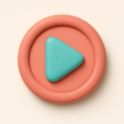

# Mighty Mini Missions UI icons

`ui-icons/` is the shared picture language for child-facing controls. The icons are soft, dimensional storybook art rather than emoji or vector symbols.

## Rule

Use the same picture for the same action in every game. Keep the written label beside it. Do not substitute an emoji.

## Actions

- `play` — start or play
- `done` — finished or yes
- `back` — back or undo
- `help` — ask for help
- `listen` — hear it again
- `talk` — speak or ask Joyce
- `hangup` — end a Joyce call
- `retry` — try again or not yet
- `watch` — watch again
- `write` — write
- `fit` — writing fits
- `open` — open another app
- `tell` — tell someone
- `turn` — your turn or next
- `stop` — stop this mission

## Mission kinds

- `lesson`
- `check`
- `game`
- `app`
- `move`
- `celebrate`
- `write`
- `bonus`

## HTML

Use an accessible text label and hide the decorative picture from screen readers:

```html
<button class="with-icon">
  <span class="btn-icon" aria-hidden="true">
    
  </span>
  <span class="btn-label">Start</span>
</button>
```
